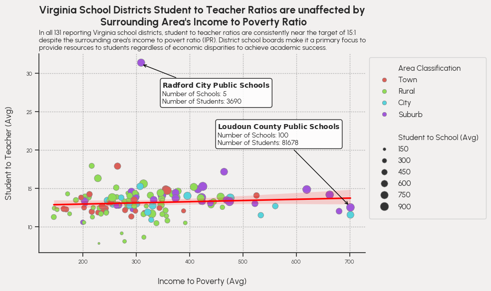

# Semester Project: Final Chart

**Evan Morris**  
CS 625, Spring 2026  
Due: Sunday, May 3, 2026

## Datasets
* *Primary Dataset*
  * **URL:** [School District Characteristics](https://catalog.data.gov/dataset/school-district-characteristics-current-ca756?from_hint=eyJxIjoic2Nob29sIGRpc3RyaWN0IGN1cnJlbnQiLCJzb3J0IjoicmVsZXZhbmNlIn0%3D)
  * **Dataset:** [Here](./data/district.csv)
  * **Description:** Data aggregated by the National Center for Education Statistics (NCES) through its Education Demographic and Geographic Estimate (EDGE) program, which includes annually updated data geographic boundaries for public elementary, secondary, and unified school districts, collected by the U.S. Census Bureau, as well as Common Core of Data (CCD) attributes such as enrollment, staffing, and grade spans.

* *Secondary Dataset*
  * **URL:** [School Neighborhood Poverty Estimates](https://catalog.data.gov/dataset/school-neighborhood-poverty-estimates-current-6e2e0?from_hint=eyJxIjoic2Nob29sIG5laWdoYm9yaG9vZCBwb3ZlcnR5IGVzdGltYXRlcyIsInNvcnQiOiJyZWxldmFuY2UifQ%3D%3D)
  * **Dataset:** [Here](./data/ipr.csv)
  * **Description:** School Neighborhood Poverty Estimates combine school location data from Common Core of Data (CCD) with income data from the U.S. Census Bureau’s American Community Survey. The dataset provides income-to-poverty ratio (IPR) estimates for surrounding neighborhoods of schools.

## Final Question
**Hypothesis:** Schools located in areas with lower Income-to-Poverty Ratios (IPR) are in districts with higher student-to-teacher ratios.

**Findings:** I originally thought that when an area's income to poverty ratio (IPR) is high, the schools would have more teachers per student due to economic, geographic, and many others reasons. What I found during my data exploration is that, regardless of the area's IPR, the student to teacher ratio resides around 15:1 for all districts except Radford City Public Schools. Therefore, I have to reject my original hypothesis.
 
 

 
Jupyter Notebook: [Here](./semester_project_cs625.ipynb)
 
Idiom: Scatterplot / Mark: Points
| Data: Attribute | Data: Attribute | Encode: Channel |
| --- | --- | --- |
| income to poverty (avg) | value, quantitative | horizontal spatial position (x-axis) |
| student to teacher (avg) | value, quantitative | vertical spatial position (y-axis) |
| area classification | key, categorical | color hue |
| student to school (avg) | value, quantitative | size |

### Description

In order to answer my chosen hypothesis for the project, I needed to be able to show the correlation between the Virginia school districts' student to teacher ratios and IPRs. These two attributes are both quantitative values so choosing the scatterplot idiom to encoding them is an appropriate direction to take. Both of these attributes were encoded using the spatial positioning of the x and y axes, allowing for the other channels such as color hue and size to be used to encode the area's classification and student to school ratio respectively. These other attributes were encoded using these channels to reinforce the findings that the school districts attempt to structure each school to maintain a student to teacher ratio of 15:1.

 

The `hls` Seaborn qualitative color palette was chosen for the color hue channel. Qualitative palettes are well-suited to represent categorical data due to their variation. The `hls` palettes contains 8 distinct hues. In order to respond to my chosen hypothesis, I plotted a regression line with a confidence interval of 95% in order to show the functional relationship between the attributes. What was shown is a slight increase to the student to teacher ratio when IPR increases but not enough to be significant while the regression line resides slightly below the target ratio of 15:1. What is visually encoded in the chart corresponds directly with the headline that Virginia school districts' student to teacher ratios are unaffacted by surrounding area's IPR.

## Final Thoughts

Prior to graphing, the development process consisted of data cleaning and training a rudimentary K nearest neighbor model outlined in the sections below. 

### Data Cleaning

The school districts dataset contains many rows of incomplete data and NaN values that needed to be removed. For the dataset to be transformed into a usable  dataset for the visualization, several attributes were dropped such as the redundant secondary address columns as well as any row containing NaN or incomplete data. Latitude and longitude attributes are included in the dataset and were used for the KNN model. This provided a geospatial representation that the models can use to pair the districts with the neighborhood poverty estimate dataset

Referencing the School District Characteristics data.gov webpage, rows needed to be validated to ensure incomplete or missing data was dropped. -1 or M indicates that the data is missing, -2 or N indicates that the data is not applicable, and -9 indicates that the data did not meet NCES data quality standards. Within the CSV, this data is represented by their numeric identifier. Each of these value's wertr filtered, and removed from the dataset to move forward with the encoding. 257 rows of unusable data were dropped from the dataset.

The initial steps to clean the neighborhood poverty estimates dataset were to verify if any NaN values were present in the dataset, remove them, and validate the IPRs value range.  The referenced school neighborhood poverty estimates webpage states each IPR's range is from 0 to 999. Validation occurred on the reported IPRs by checking the range of each row, all were within the stated constraint. With every IPR value validated, the school neighborhood poverty estimates dataset was cleaning was complete. The attribute used from this dataset are as follows: ['Name', 'IPR_EST', 'x', 'y'].

### KNN Machine Learning for Districting

In order to associate the district's enrollment to the surrounding school's IPR from two different datasets, distance from the centerpoint of a district needed to be measure. The Euclidean Distance formula is able to compute the distance of each (x,y) coordinate from each district to coordinates in the other dataset to find the closest distance to each district. The library SciPy was used to assist in computing this measure using the following formula: 
   

$$
\
d(\mathbf{x}, \mathbf{y}) = \sqrt{\sum_{i=1}^{n} (x_i - y_i)^{2}}
\
$$

  

The Euclidean Distance formula was used in calculating the distance between each school with each district $n$ to form distance vector $D$ as shown below. Since $k =1$ and the nearest neighbor determines the district, the minimum value in each row was set to be each school's associated nearest district.

  

$$
\
D = \begin{bmatrix}
d(x_{1},y_{1} ) & d(x_{1},y_{2} ) & ... & d(x_{1},y_{n} )\\
d(x_{2},y_{1} ) & d(x_{2},y_{2} ) & ... & d(x_{1},y_{n} )\\
\vdots & \vdots & \ddots & \vdots \\
d(x_{m},y_{1} ) & d(x_{m},y_{2})
& ... & d(x_{m},y_{n})  
\end{bmatrix}
\
$$

Two new columns were then created, `Distance` and `District` that contained the distance measuring results. This allowed that each IPR could easily be associated with a school district's data. From there I was able to do exploratory analysis of the data and finally start planning of the visualization.

The most challenging aspect of the project was trying to relate the two datasets in order to join the data for a more interesting final visualization. This was to attempt to find a meaningful response to the hypothesis. From searching for the datasets to the final visualization, I would estimate it took around 20 accumulative hours in order to research, clean, and relate the data. I further utilized these datasets in my machine learning class where I predicted area classification through a multi-layer perceptron and other classification models. This is where some of my time was spent during the research process and how I had the idea on how to join the two datasets. Learning Seaborn text annotations were also a challenging aspect but a great way for adding additional context onto the visualization that I will further explore in future visualizations.

## References
* scipy - Documentation, <https://docs.scipy.org/doc/scipy/>
* pandas - Documentation, <https://pandas.pydata.org/docs/>
* seaborn - Documentation, <https://seaborn.pydata.org/api.html>
* matplotlib - Documentation, <https://matplotlib.org/stable/>
* Ashkan Mirzaee - Markdown and LaTeX, <https://ashki23.github.io/markdown-latex.html#:~:text=We%20can%20use%20LaTeX%20to,a%20double%20%24%20to%20display%20equations.>
* United States Census Bureau, <https://census.gov>
